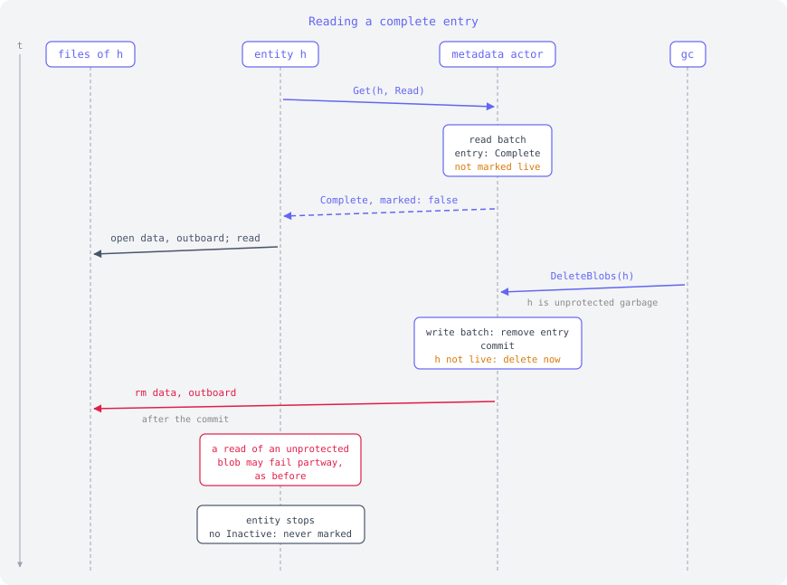
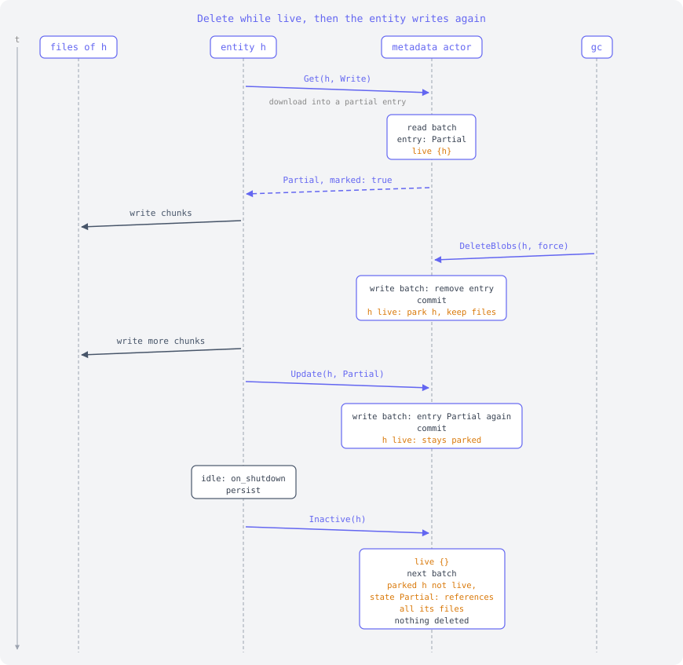
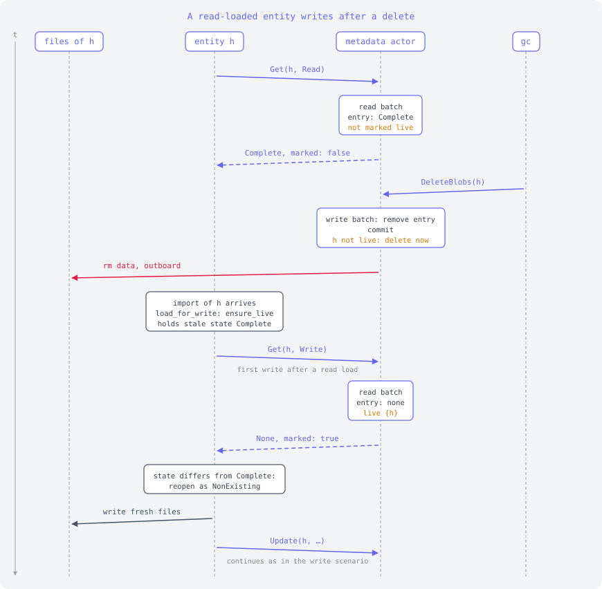
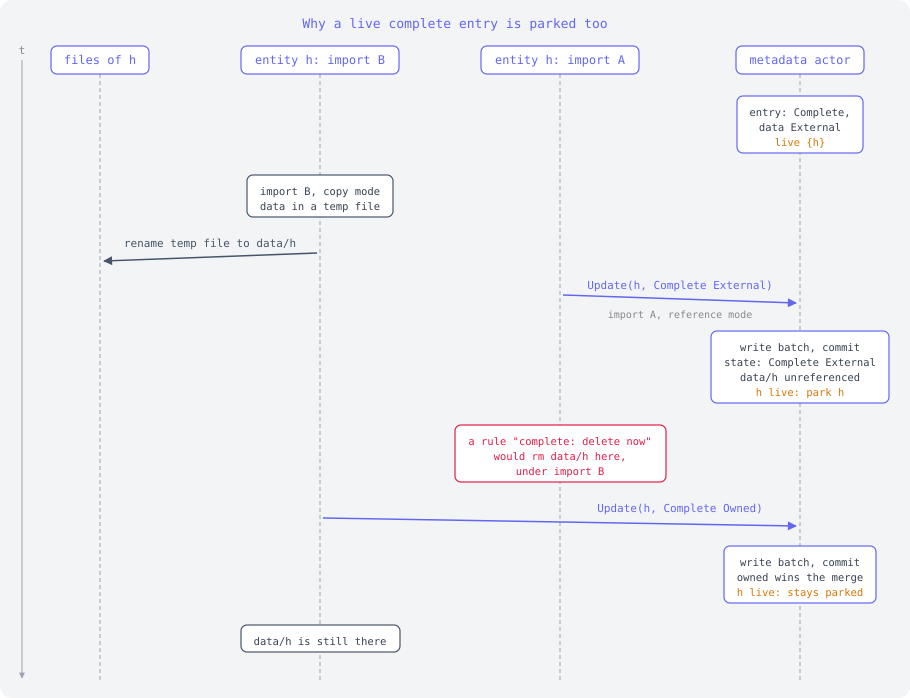

# fs store file deletes: scenarios

Sequence diagrams for the protocol in [fs-store-file-deletes.md]. Time runs
down. Each lane is one actor:

- **files of h**: the data, outboard, sizes and bitfield files of one hash.
- **entity h**: the entity actor for the hash, which does file IO directly.
- **metadata actor**: owns redb, handles commands in one FIFO, groups them into
  read or write batches, and deletes files after a batch.
- **gc**: stands for anything that sends `DeleteBlobs` through the main actor.

Indigo arrows are messages to and from the metadata actor (dashed: reply),
slate arrows are file IO by the entity, rose arrows are file deletes. Amber
text is the metadata actor's `live` and `parked` bookkeeping.

## Reading a complete entry

A read costs one `Get(Read)`, and a complete entry is not marked live, so
the entity never sends `Inactive`. Nothing protects the reader: if gc deletes
the entry, its files go right after the commit. Only blobs that nothing
protects are affected, as before.

## Writing

`Get(Write)` marks the hash live before the entity touches any file. Every
batch that writes `h` parks it while it is live. The files that the final
`Complete` state no longer needs (sizes, bitfield) are deleted only after
`Inactive`, in the first batch after it. That batch can be a read batch,
since everything is committed by then.

## Delete while the entity is live

This is `test_delete_waits_for_live_entity`. An observe stream on a partial
entry keeps the entity live. A forced delete removes the entry at once, but
the files stay until the entity sends `Inactive`. Then the entry is gone,
so all four files are deleted.

## Delete while live, then the entity writes again

Same start, but the entity keeps writing after the delete. Its `Update`
recreates the entry, which references the files the entity kept writing to.
When the entity is done, the final state is `Partial`, so nothing is
deleted.

## A read-loaded entity writes after a delete

An entity loaded for reading a complete entry is not live, so gc can delete
the entry and its files while the entity still holds the old `Complete`
state. The first write then calls `ensure_live`, which sends `Get(Write)`.
The reply carries the current state, so the entity sees that the entry is gone
and opens it again as `NonExisting` before writing.

## Why a live complete entry is parked too

`finish_import` moves the temp file into place before it sends its update,
even if the entry is already complete. Here import A (reference mode) updates
the entry between import B's rename and B's update. At that point the state
is `Complete` with external data, so `data/h` is unreferenced. A rule that
deletes unreferenced files of a complete entry right away, live or not, would
remove the file B just moved into place, and B's update would then make the
entry point at it. Parking every live hash avoids this.

## Not shown: crashes

Parked deletes live only in memory. After a crash, the files of hashes that
were parked stay on disk until something writes the hash again. The planned
fix is a sweep at open after an unclean shutdown: list the data directory and
delete the files that no entry references. No entity is live at that point.

[fs-store-file-deletes.md]: fs-store-file-deletes.md
