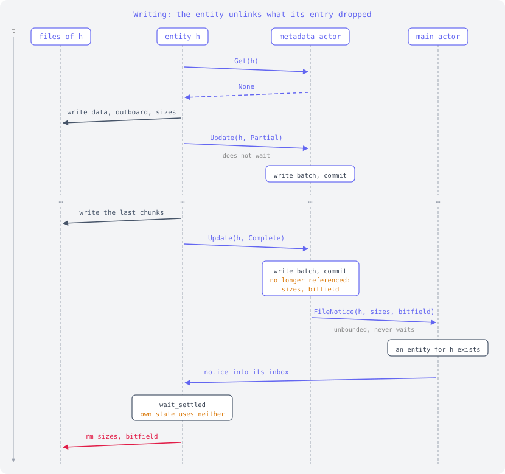
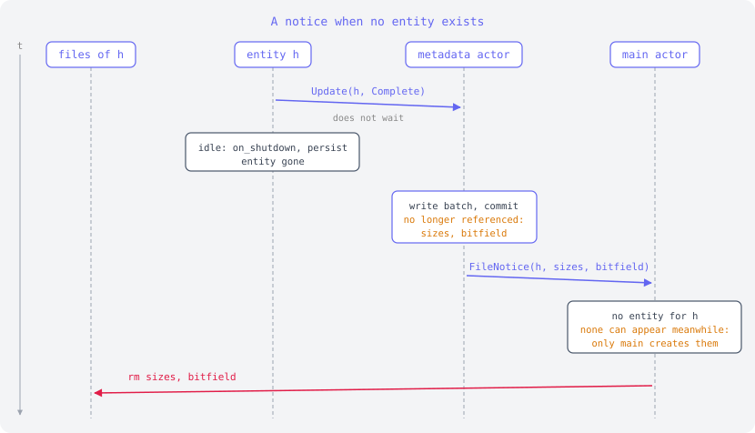
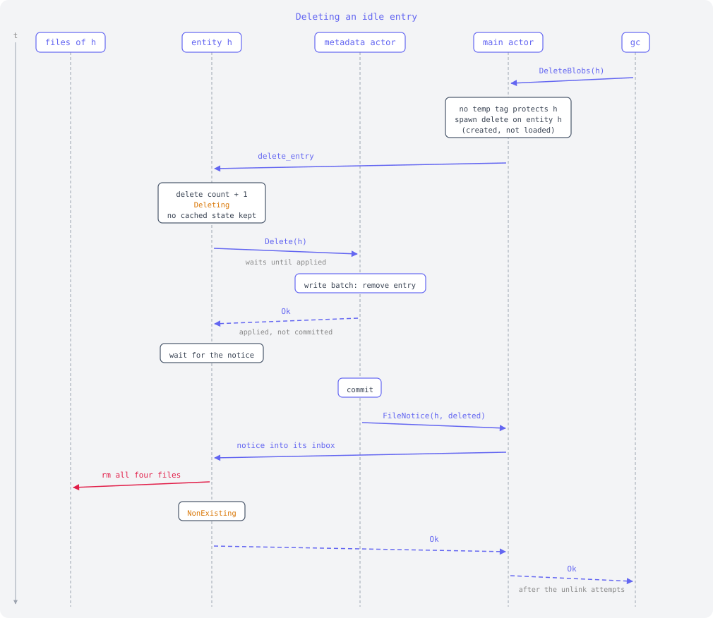
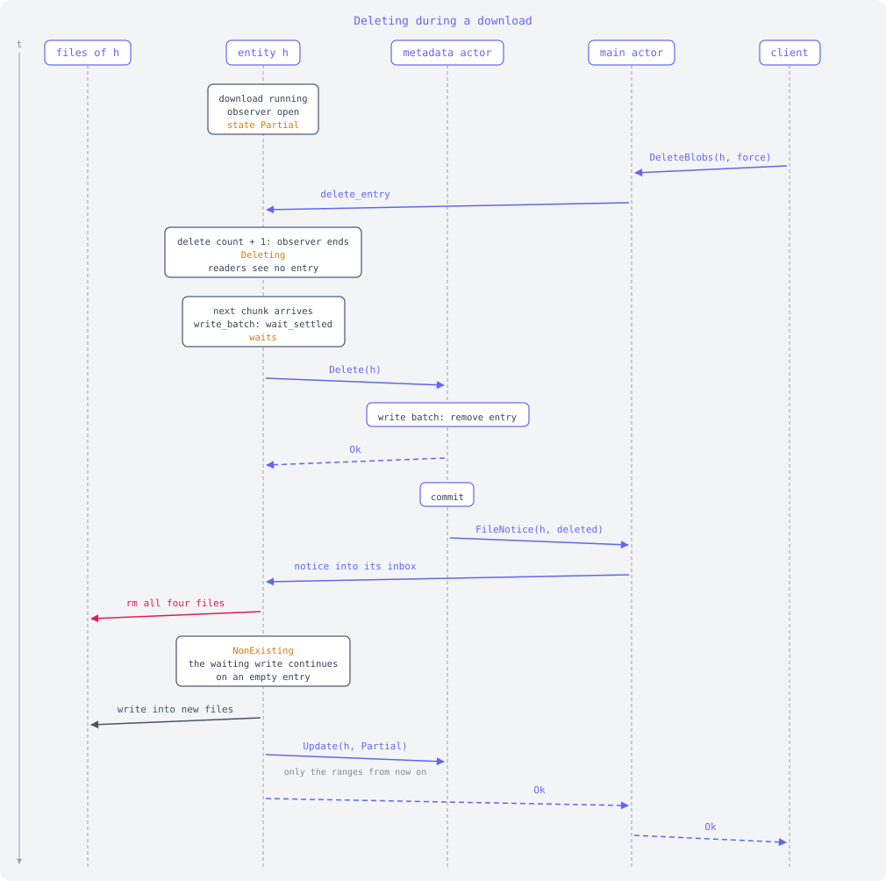
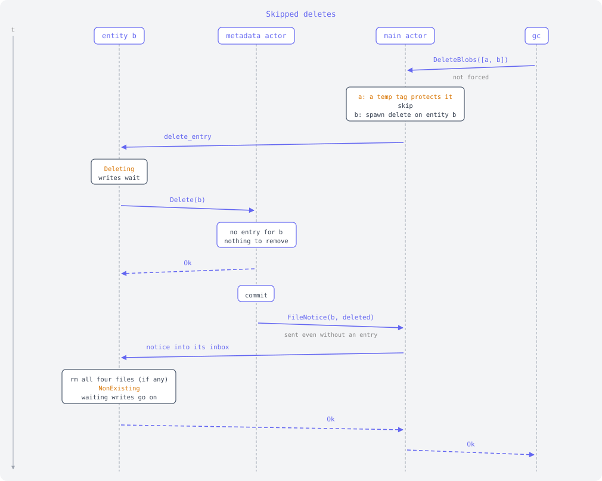
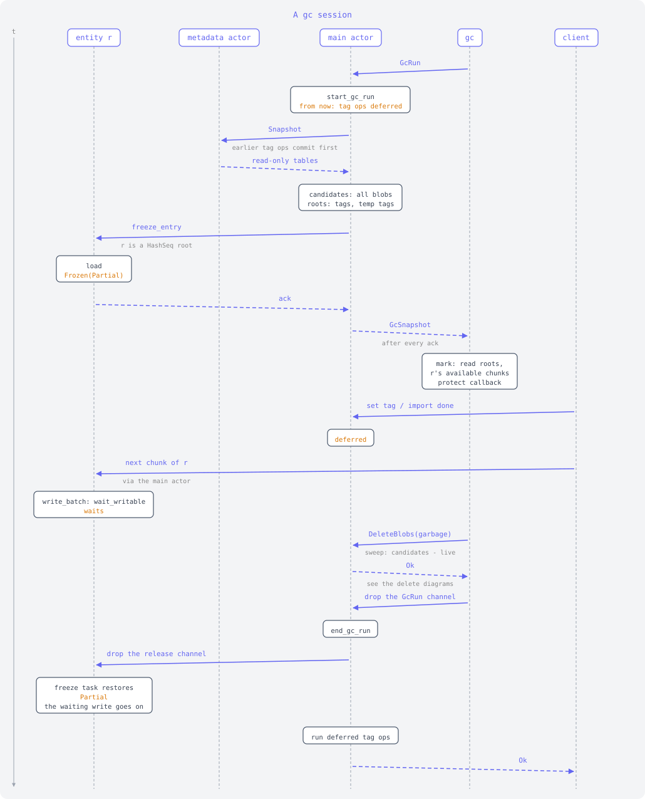
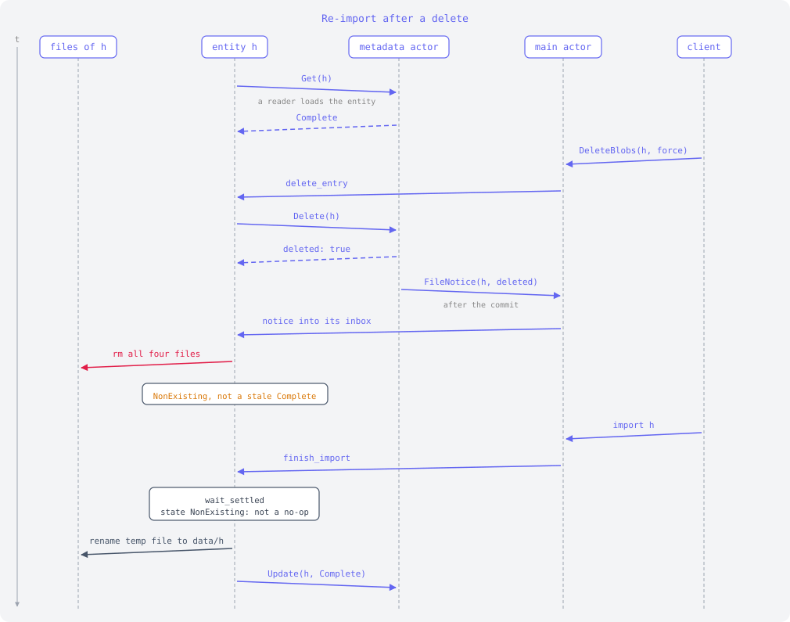

# fs store file deletes: scenarios

Sequence diagrams for the protocol in [fs-store-file-deletes.md]. Time runs
down. Each lane is one actor:

- **files of h**: the data, outboard, sizes and bitfield files of one hash.
- **entity h**: the entity actor for the hash. It is the only one that writes
  and deletes these files while it exists.
- **metadata actor**: owns redb, handles commands in one FIFO, and groups them
  into read or write batches. It never touches data files, and after each
  commit it sends a `FileNotice` per hash to the main actor.
- **main actor**: creates entities, routes notices, fans deletes out to
  entities, and holds the temp tags.
- **gc** / **client**: whoever sends `DeleteBlobs` or imports.

Indigo arrows are messages (dashed: reply), slate arrows are file IO,
rose arrows are file deletes. Amber text is entity state or bookkeeping.

## Writing

Once the entry is `Complete`, the commit no longer references sizes and
bitfield. The notice goes through the main actor to the entity, which
unlinks only files its own state does not use. The entity's state is never
behind its entry.

## A notice when no entity exists

`update` does not wait, so the entity can be gone before the commit. The main
actor then unlinks the files itself. Only it creates entities, so none can
appear in between, and no writes are in flight.

## Deleting an idle entry

Every delete goes through the hash's entity, which the main actor creates
without loading. The entity holds `Deleting` until the notice of the commit
has unlinked the files, which also keeps it alive so it cannot unload and come
back with files the unlink would take. `DeleteBlobs` returns once the files
are gone.

## Deleting during a download

While the entity is `Deleting`, readers and observers look through to the old
state, and writes wait. Once the delete is applied, the delete count ends the
observer. After the unlink, the waiting write continues on an empty entry, so
the download keeps only the ranges that arrive from then on.

## Skipped deletes

A delete that is not forced skips content a temp tag protects. The main actor
checks this before fanning out, so the entity never sees it. A delete of a
hash without an entry restores the entity's old state, and the writes that
waited go on as if nothing happened.

## A gc run protects what had a temp tag

A gc run is a `GcRun` request that lasts until gc drops it. Content that had a
temp tag at any time during the run is kept by deletes that are not forced,
even if the tag was dropped. That covers imports after the mark, and
handovers between temp tags and named tags. Untagged content has no
protection.

## Re-import after a delete

The bug this design fixes: before, an entity that had loaded `Complete` kept
that state after a delete, so a later import of the same blob was a no-op and
the blob stayed gone. Now the delete goes through the entity, so it is
`NonExisting` and the import writes.

## Not shown: crashes

A crash between a commit and the unlink of its notice leaves files that
nothing references. A sweep at open after an unclean shutdown is planned.

[fs-store-file-deletes.md]: fs-store-file-deletes.md
